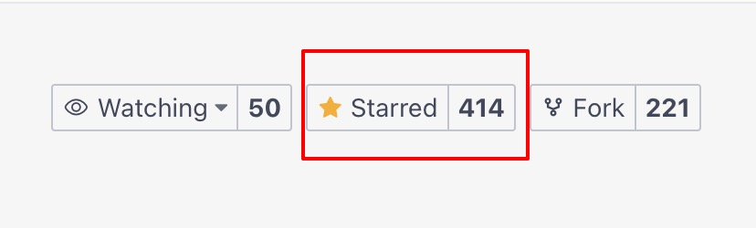

# 启航小店管家

**把返现、补发、补款、退款和推广费，算进每一单。**

面向 2-5 人小电商团队的真实利润工具。不需要接平台 API，订单用 Excel 导入就能算清每个链接、每个店铺到底赚了多少。

本仓库是**开源版**：单机部署、单账号使用，不含多租户与商业版功能，可直接用于自己的店铺或二次开发。

---

## 一、它解决什么问题

| 你遇到的问题 | 实际情况 |
|---|---|
| 月底算利润，算出来和感觉差很多 | 返现、补款、补发都发生在微信里，压根没进账 |
| 不知道哪个链接在亏钱 | 推广费只有一个总数，不知道摊到哪个款上 |
| 退款了，推广费却退不回来 | 退货的成本只算了退款，没算运费、包装和货损 |
| 客服记不住售后花了多少 | 没有地方记，全靠聊天记录翻 |
| 请不起专职财务 | Excel 越做越乱，链接一多就崩 |

平台后台只告诉你卖了多少，不告诉你赚了多少。小店管家就是来补上这一块的。

---

## 二、功能

### 工单（售后支出记账）
- 类型：补款 / 返现 / 补发 / 仅退款 / 退货退款 / 其他
- 选类型 → 填金额 → 选订单（可后补）→ 提交，10 秒记一笔
- 补发工单自动扣库存
- 待处理置顶、结算跟踪

### 商品与成本
- 商品档案：名称、规格、成本价
- 成本价行内编辑、Excel 批量导入、未填成本筛选
- 商品分类与属性

### 订单导入
- 支持淘宝/天猫、拼多多、抖店等后台导出的 Excel
- 表头映射模板，首次配置后一键复用
- 预览后入库，重复订单号自动防重
- 也支持手动建单补录零星订单

### 费用
- 推广费：按推广计划/链接录入，按实收占比自动分摊
- 固定费用：房租、人工等按月录入
- 对账单：平台账单导入并按订单号匹配

### 利润表（三层级）
| 层级 | 回答的问题 |
|---|---|
| 订单贡献利润 | 这一单赚不赚 |
| 链接贡献利润 | 这个款扣掉推广费后赚不赚 |
| 店铺净利润 | 这个月扣掉人工房租后赚不赚 |

每层展示：收入、商品成本、快递、平台扣费、售后成本、推广费、利润、利润率。报表顶部提示数据完整度（未匹配成本 / 推广费未录 / 待处理工单），清零后数字才可信。

### 店铺管理
- 多店铺独立核算（同一账号管理多个店铺，非多租户）
- 店铺档案：店铺名、平台类型、卖家ID、备注
- 店铺平台配置：各平台的 AppKey / AppSecret / 回调地址（手动记账场景可留空）
- 店铺利润按店铺维度出报表

### 数据导出
- 商品分类、字典类型、字典数据、利润报表均可一键导出 Excel（xlsx）

---

## 三、技术栈

| 层 | 技术 |
|---|---|
| 后端 | Java 17 + Spring Boot 3 + MyBatis-Plus + Spring Security(JWT) |
| 数据库 | MySQL 8（utf8mb4） |
| 缓存 | Redis 7 |
| 前端 | Vue 2 + Element UI + Avue（Vue CLI 4） |
| 部署 | Docker / Docker Compose / Nginx |

---

## 四、快速开始（Docker Compose，推荐）

```bash
git clone https://gitee.com/qiliping/qihang-shops.git
cd qihang-shops

docker compose up -d --build
```

启动完成后访问 `http://localhost`(Web 端口映射在 `docker-compose.yml` 的 `web` 服务中调整)。

- 默认账号：`admin`
- 默认密码：`admin123`

首次启动时 MySQL 会自动执行 `docs/sql/schema.sql`（表结构）和 `docs/sql/seed.sql`（初始数据：菜单、字典、管理员账号、店铺平台）。

> 数据保存在 `mysql-data`、`redis-data` 两个数据卷中，`docker compose down` 不会删除数据；彻底重置请加 `-v`。

---

## 五、本地开发

### 5.1 准备中间件

```bash
# MySQL 8
docker run -d --name qihang-mysql -p 3306:3306 \
  -e MYSQL_ROOT_PASSWORD=root -e MYSQL_DATABASE=qihang_shop \
  mysql:8.0 --character-set-server=utf8mb4 --collation-server=utf8mb4_general_ci

# Redis 7
docker run -d --name qihang-redis -p 6379:6379 redis:7-alpine
```

初始化数据库：

```bash
mysql -uroot -proot qihang_shop < docs/sql/schema.sql
mysql -uroot -proot qihang_shop < docs/sql/seed.sql
```

### 5.2 启动后端

```bash
cd api
mvn spring-boot:run
```

后端端口 `8098`，接口文档见各 Controller 注释（未启用 Swagger）。

### 5.3 启动前端

```bash
cd vue
npm install
npm run dev
```

访问 `http://localhost:88`，开发环境 `/dev-api` 已代理到 `http://localhost:8098`。

### 5.4 打包

```bash
# 后端
cd api && mvn clean package        # 产物 api/target/api-1.0.506.jar

# 前端
cd vue && npm run build:prod       # 产物 vue/dist
```

前端 Nginx 配置参考 `vue/nginx.conf`：静态目录 + `/prod-api/` 反向代理到后端。

---

## 六、配置项

后端配置直接写在 `api/src/main/resources/application.yaml` 中，需要修改时直接编辑该文件：

| 配置 | 当前值 | 说明 |
|---|---|---|
| MySQL 地址 | `127.0.0.1:3306/qihang_shop` | 本机 Docker MySQL（`my-mysql8` 容器） |
| MySQL 账号 | `root` | 密码为作者本机默认密码，请自行修改 |
| Redis | `127.0.0.1:6379` 无密码 | 本机 Docker Redis（`my-redis` 容器） |
| 后端端口 | `8098` | 前端开发代理与 Nginx 均已对应 |
| JWT 秘钥 | 内置默认值 | **生产环境务必修改** |

---

## 七、目录结构

```
qihang-shops/
├── api/                    # Spring Boot 后端
│   └── src/main/java/cn/qihangerp/api/
│       ├── controller/     # 接口：工单、订单导入、费用、利润、店铺、系统
│       ├── service/        # 业务逻辑（利润引擎、订单导入、工单结算）
│       ├── mapper/         # MyBatis-Plus Mapper
│       └── domain/         # 实体
├── vue/                    # Vue 2 前端
│   └── src/views/          # 工单 / 订单 / 费用 / 利润 / 商品成本 / 店铺设置
├── docs/sql/
│   ├── schema.sql          # 表结构（70 张表）
│   └── seed.sql            # 初始数据（管理员、菜单、字典、店铺平台）
├── smoke-test.ps1          # 接口冒烟测试脚本（需先启动后端）
└── docker-compose.yml
```

---

## 八、常见问题

**忘记管理员密码怎么办？**

重置为 `admin123`：

```sql
UPDATE sys_user
SET password = '$2a$10$7JB720yubVSZvUI0rEqK/.VqGOZTH.ulu33dHOiBE8ByOhJIrdAu2'
WHERE user_name = 'admin';
```

**端口被占用？**

改 `api/src/main/resources/application.yaml` 的 `server.port`，Docker 部署则改 `docker-compose.yml` 中 `web`/`api` 的端口映射（映射后需同步改 `vue/nginx.conf` 的代理目标）。

**如何升级？**

拉取新代码后 `docker compose up -d --build`；若 `docs/sql/schema.sql` 有结构变更，请自行比对并执行差异 ALTER（数据卷中的旧库不会被自动迁移）。

本次版本新增/变更（老库需手动执行）：

```sql
-- 新增角色部门关联表
CREATE TABLE `sys_role_dept` (
  `role_id` bigint NOT NULL COMMENT '角色ID',
  `dept_id` bigint NOT NULL COMMENT '部门ID',
  PRIMARY KEY (`role_id`,`dept_id`) USING BTREE
) ENGINE=InnoDB DEFAULT CHARSET=utf8mb4 COLLATE=utf8mb4_general_ci ROW_FORMAT=DYNAMIC COMMENT='角色与部门关联';

-- 菜单新增：店铺平台 + 店铺/订单/分类相关权限项（menu_id 从 2073 起）
-- 建议直接用最新的 docs/sql/seed.sql 的 sys_menu / sys_role_menu 做增量同步
```

**能不能多账号？**

开源版只提供单账号（超级管理员）。需要多账号/多租户请参考商业版。

**如何跑接口冒烟测试？**

先启动后端（`cd api && mvn spring-boot:run`），确保 MySQL / Redis 可用，然后执行：

```powershell
powershell -ExecutionPolicy Bypass -File .\smoke-test.ps1
```

脚本会登录 `admin/admin123`，逐项校验核心接口、动态菜单、Excel 导出、补发工单扣库存、头像上传等 44 项断言。脚本默认校验 `http://127.0.0.1:8098`，改端口请修改脚本顶部的 `$base`。

---

## 九、开源协议

[MIT](LICENSE)

---

## 十、支持一下

**感谢大家的关注与支持！希望利用本人从事电商 10 余年的经验帮助到大家提升工作效率！**

💖 如果觉得有用记得点个 Star ⭐

### 一起交流



### 捐助作者

作者为兼职做开源，平时还需要工作，如果帮到了您可以请作者吃个盒饭。

| 微信 | 支付宝 |
|---|---|
|  |  |

### 关注公众号


